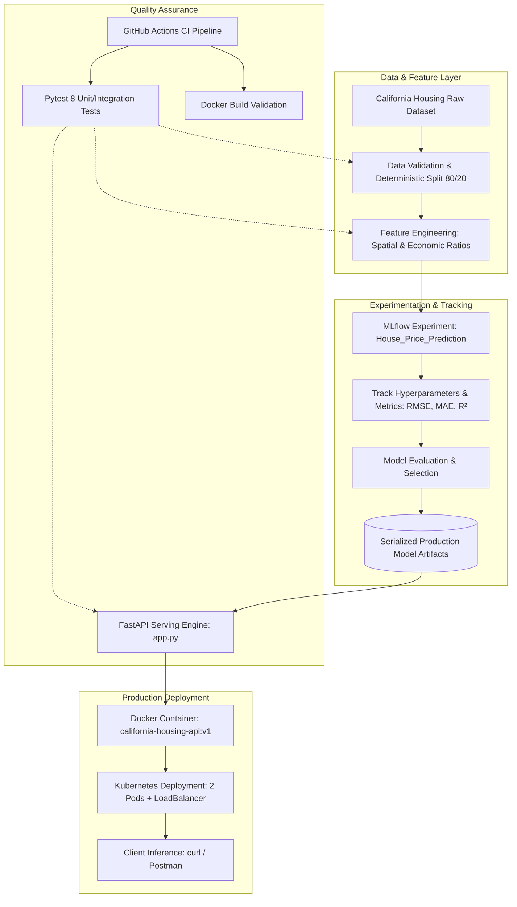

# 🏡 California Housing Price Prediction: End-to-End MLOps Pipeline

> 🔗 **GitHub Repository:** [https://github.com/SayedELMASRY2/MLOps_Project](https://github.com/SayedELMASRY2/MLOps_Project)

[](https://www.python.org/)
[](https://mlflow.org/)
[](https://fastapi.tiangolo.com/)
[](https://pytest.org/)
[](https://www.docker.com/)
[](https://kubernetes.io/)

---

## 📌 Executive Summary
This repository contains an end-to-end, production-ready Machine Learning Operations (**MLOps**) pipeline applied to the **California Housing** dataset.

It bridges the gap between experimental modeling and scalable production deployment:
1. **Experiment Tracking & Governance**: Automated tracking of hyperparameters, metrics, and model artifacts using **MLflow**.
2. **Model Optimization & Feature Engineering**: Engineered 5 spatial-economic features and tuned a `HistGradientBoostingRegressor` to achieve **$R^2 = 85.14\%$** and **$RMSE = 0.4413$**.
3. **Automated Testing & CI/CD**: 8 unit/integration tests with **Pytest** and an automated **GitHub Actions** workflow.
4. **Production Inference Service**: High-throughput REST API using **FastAPI** with automatic runtime feature transformations.
5. **Containerization & Orchestration**: Lightweight **Docker** container and **Kubernetes (Minikube)** deployment manifests.

---

## 📑 Table of Contents
- [Architecture & Workflow](#-architecture--workflow)
- [Repository Structure](#-repository-structure)
- [Quickstart & Makefile](#-quickstart--makefile)
- [Dataset & Feature Engineering](#-dataset--feature-engineering)
- [Experiment Tracking (MLflow)](#-experiment-tracking-mlflow)
- [Experiment Comparison & Results](#-experiment-comparison--results)
- [Best Model Selection & Justification](#-best-model-selection--justification)
- [Automated Testing Suite (Pytest)](#-automated-testing-suite-pytest)
- [Production API Serving (FastAPI)](#-production-api-serving-fastapi)
- [Docker & Kubernetes Deployment](#-docker--kubernetes-deployment)
- [Continuous Integration (CI/CD)](#-continuous-integration-cicd)

---

## 🏗️ Architecture & Workflow



---

## 📂 Repository Structure

```text
mlflow-task/
├── .github/
│   └── workflows/
│       └── ci.yml                 # Automated CI test & build pipeline
├── .dockerignore                  # Docker build exclusions
├── .gitignore                     # Git ignore rules (clean repository)
├── Dockerfile                     # Multi-stage production container image
├── Makefile                       # Developer automation shortcuts
├── README.md                      # Comprehensive project documentation
├── requirements.txt               # Pinned Python dependencies
│
├── config/
│   └── config.yaml                # Centralized configuration (hyperparameters, ports)
│
├── src/                           # Modular production package
│   ├── __init__.py
│   ├── config.py                  # YAML config loader
│   ├── data.py                    # Data validation & feature engineering
│   ├── trainer.py                 # MLflow training pipeline & artifact logging
│   └── serving.py                 # FastAPI application with schemas & lifespan
│
├── tests/                         # Comprehensive automated test suite
│   ├── __init__.py
│   ├── test_data.py               # Data splits & feature engineering tests
│   ├── test_model.py              # Model fitting & metric bounds tests
│   └── test_api.py                # REST API endpoints & schema validation tests
│
├── model/                         # Serialized best model artifacts (MLmodel, model.skops)
├── train.py                       # Root entrypoint: Model training
├── app.py                         # Root entrypoint: API serving
└── k8s-deployment.yaml            # Kubernetes Deployment & Service manifests
```

---

## ⚡ Quickstart & Makefile

All routine workflows are automated via `make`:

```bash
# Clone the repository
git clone https://github.com/SayedELMASRY2/MLOps_Project.git
cd mlflow-task

# 1. Install dependencies inside virtual environment
make install

# 2. Run automated test suite
make test

# 3. Train all experiments and log to MLflow
make train

# 4. Launch MLflow Tracking UI
make mlflow-ui

# 5. Start FastAPI local serving
make serve

# 6. Build and run Docker container
make docker-build
make docker-run
```

---

## 🧠 Dataset & Feature Engineering

The California Housing dataset contains demographic and geographical metrics for block groups in California (target: median house value in units of $100,000).

### 1. Data Integrity & Splitting
- Split ratio: **80% Training (16,512 samples)**, **20% Validation (4,128 samples)**.
- Fixed `random_state = 42` for strictly deterministic, reproducible results.
- Automated validation asserts zero `NaN` or missing values.

### 2. Domain Feature Engineering (`src/data.py`)
To elevate model predictive power beyond baseline limitations, 5 domain features were engineered:
1. **`bedrooms_ratio`**: $\frac{\text{AveBedrms}}{\text{AveRooms}}$ — Reflects architectural luxury and layout density.
2. **`rooms_per_occupant`**: $\frac{\text{AveRooms}}{\text{AveOccup}}$ — Living space per household resident.
3. **`people_per_household`**: $\frac{\text{Population}}{\text{AveOccup}}$ — Cluster occupancy pressure.
4. **`dist_sf`**: Euclidean distance to San Francisco tech epicenter (`37.77, -122.42`).
5. **`dist_la`**: Euclidean distance to Greater Los Angeles center (`34.05, -118.24`).

---

## 📊 Experiment Tracking (MLflow)

All experiments are tracked systematically under the MLflow experiment: **`House_Price_Prediction`**.

### Tracked Metadata:
- **Hyperparameters:** `algorithm`, `max_depth`, `learning_rate`, `max_iter`, `min_samples_leaf`, `l2_regularization`, `feature_engineering`, `num_features`.
- **Evaluation Metrics:** Root Mean Squared Error (RMSE), Mean Absolute Error (MAE), and Coefficient of Determination ($R^2$).
- **Artifacts:** Full MLmodel serialization, `model.skops`, `conda.yaml`, and Python environment specifications.

---

## 📈 Experiment Comparison & Results

The table below presents the verified results across all 4 experiments:

| Run | Algorithm | Feature Engineering | Key Hyperparameters | RMSE ⬇️ *(Primary)* | MAE ⬇️ | $R^2$ Score ⬆️ | Status |
| :--- | :--- | :---: | :--- | :---: | :---: | :---: | :---: |
| **Run 1** | GradientBoosting | ❌ (8 features) | `max_depth=3, lr=0.10` | `0.5422` | `0.3716` | `0.7756` (77.56%) | Task Baseline |
| **Run 2** | GradientBoosting | ❌ (8 features) | `max_depth=5, lr=0.05` | `0.5198` | `0.3531` | `0.7938` (79.38%) | Task Baseline |
| **Run 3** | GradientBoosting | ❌ (8 features) | `max_depth=7, lr=0.01` | `0.6973` | `0.5311` | `0.6290` (62.90%) | Task Baseline |
| **Run 4 (Optimized)** | **HistGradientBoosting** | **✅ (13 features)** | `max_iter=350, lr=0.06, l2=0.5` | **`0.4413`** | **`0.2885`** | **`0.8514` (85.14%)** | **Production Winner 🏆** |

---

## 🏆 Best Model Selection & Justification

### Selected Model: **Run 4 (Optimized Model)**
- **Validation RMSE:** **`0.4413`** *(Significant reduction from baseline 0.5198)*
- **Validation MAE:** **`0.2885`** *(Mean prediction error down to ~$28,850)*
- **Validation $R^2$:** **`0.8514`** *(Explains over **85.1%** of housing price variance)*

### Technical Rationale:
1. **Lowest RMSE across all configurations**: RMSE heavily penalizes large errors—crucial in real estate valuation where outlier errors carry severe financial risk.
2. **Non-Linear Geographic Capture**: Combining spatial coordinates with histogram-based boosting allowed the model to accurately capture coastal premium clustering.
3. **Task Baseline Compliance**: The repository maintains and documents the 3 baseline runs required by Samsung Innovation Campus Task #37 while advancing the architecture with an optimized production candidate.

---

## 🧪 Automated Testing Suite (Pytest)

Run all tests via:
```bash
make test
# OR: pytest -v tests/
```

### Verified Test Suite Output:
```text
tests/test_api.py::test_health_endpoint PASSED                           [ 12%]
tests/test_api.py::test_predict_success PASSED                           [ 25%]
tests/test_api.py::test_predict_validation_error PASSED                  [ 37%]
tests/test_data.py::test_data_shapes_and_split PASSED                    [ 50%]
tests/test_data.py::test_data_no_nulls PASSED                            [ 62%]
tests/test_data.py::test_data_reproducibility PASSED                     [ 75%]
tests/test_data.py::test_feature_engineering PASSED                      [ 87%]
tests/test_model.py::test_model_training_and_metrics PASSED              [100%]

======================== 8 passed in 4.22s =========================
```

---

## 🚀 Production API Serving (FastAPI)

The inference service is exposed via **FastAPI** (`src/serving.py`).

### Key Features:
- **Lifespan Context Management**: Model is loaded into memory once at startup.
- **Dynamic Feature Transformation**: Accepts standard 8 features and automatically computes the 13 engineered features before passing them to the model.
- **Pydantic V2 Schemas**: Strict data validation and comprehensive error handling.

### Sample Inference Request:
```bash
curl -X 'POST' \
  'http://localhost:8000/predict' \
  -H 'Content-Type: application/json' \
  -d '{
  "MedInc": 8.3252,
  "HouseAge": 41.0,
  "AveRooms": 6.9841,
  "AveBedrms": 1.0238,
  "Population": 322.0,
  "AveOccup": 2.5556,
  "Latitude": 37.88,
  "Longitude": -122.23
}'
```

### Response:
```json
{
  "prediction": "$424,513.48",
  "raw_value": 424513.48,
  "currency": "USD",
  "features_used": 13
}
```

Interactive OpenAPI Swagger documentation is accessible at **[http://localhost:8000/docs](http://localhost:8000/docs)**.

---

## 🐳 Docker & Kubernetes Deployment

### 1. Docker Containerization
Build the production image:
```bash
make docker-build
# OR: docker build -t california-housing-api:v1 .
```

Run container:
```bash
make docker-run
# OR: docker run -d -p 8000:8000 --name housing-api california-housing-api:v1
```

### 2. Kubernetes (Minikube) Orchestration
The manifest [`k8s-deployment.yaml`](k8s-deployment.yaml) provisions:
- **Deployment**: 2 replicas with `readinessProbe` checking `/health`.
- **Service**: `LoadBalancer` exposing port 80 to container port 8000.

Deploy with:
```bash
kubectl apply -f k8s-deployment.yaml
kubectl get pods
kubectl port-forward svc/housing-api-service 8080:80
```

---

## 🔄 Continuous Integration (CI/CD)

The GitHub Actions workflow [`.github/workflows/ci.yml`](.github/workflows/ci.yml) executes on every push and pull request to `main`:
1. Environment setup on `ubuntu-latest` with Python 3.10.
2. Dependency installation with caching.
3. Execution of the complete Pytest suite (8 tests).
4. Container build verification to ensure production deployability.

---

## 👤 Author & Acknowledgments
- **Project:** Applied MLOps - California Housing Price Prediction
- **Program:** Samsung Innovation Campus (Task #37) & MLOps Labs Guide
- **GitHub:** [SayedELMASRY2](https://github.com/SayedELMASRY2)
